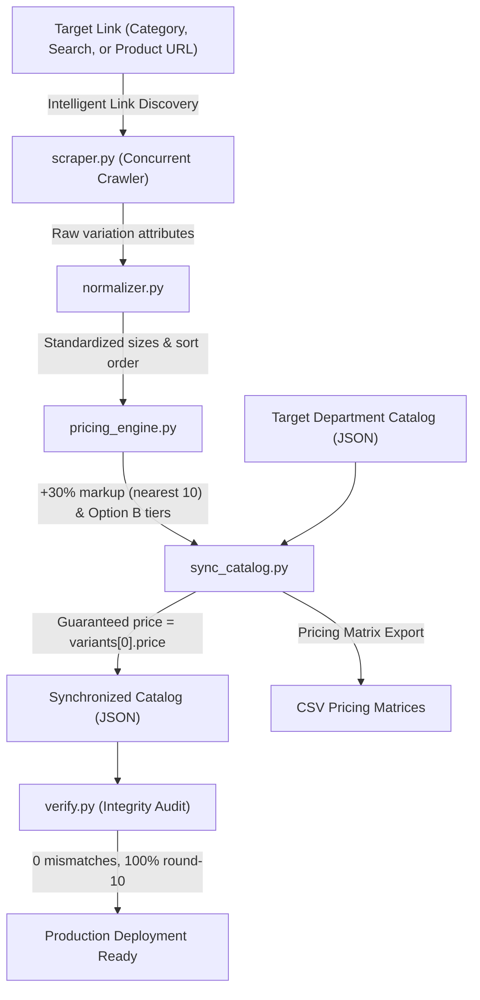

# variant-price-add

Enterprise multi-variant pricing synchronization, supplier scraper, and catalog consistency engine for craft and raw cosmetic ingredients e-commerce.

---

## 1. Executive Overview

In e-commerce catalogs offering raw chemicals, botanical bases, fragrance oils, and waxes, products are sold across heterogeneous metric sizes (e.g. `50 G`, `100 ml`, `200 G`, `500 ml`, `1 Litre`, `1 Kg`, `5 Kg`, `25 Kg`).

This repository provides an automated, idempotent pipeline to:
1. **Intelligently crawl supplier categories, search queries, and product links** from WooCommerce backend stores.
2. **Normalize heterogeneous volume and weight labels** into standardized ascending metric sizes.
3. **Calculate profit-optimized retail markups (+30%)** rounded cleanly to the nearest ₹10.
4. **Generate Option B wholesale volume tiers** (1–9 units, 10–49 units, 50+ units).
5. **Guarantee Zero-Discrepancy Catalog Invariants**, ensuring product shelf cards (`From ₹{price}`) always strictly match the starting variant on the product detail page.

---

## 2. Architecture & Pipeline



---

## 3. Intelligent Supplier Crawler Capabilities

Can it crawl a target link to go through supplier prices? **Yes, completely automated.**

The crawler (`src/scraper.py`) accepts:
- **Category URLs:** e.g. `https://jindeal.com/product-category/liquid-base/`
- **Search Query URLs:** e.g. `https://jindeal.com/?s=flavor+oil&post_type=product&dgwt_wcas=1`
- **Direct Product URLs:** e.g. `https://jindeal.com/product/vedini-orange-natural-flavor/`

### How the Crawler Operates:
1. **Automatic Type Detection:** Distinguishes between single product pages, category taxonomies, and search queries.
2. **Automatic Pagination Discovery:** Automatically traverses `/page/1/`, `/page/2/`, etc., until all products are discovered or HTTP 404 is encountered.
3. **Multi-Threaded Concurrent Scraping:** Spawns a worker pool (`ThreadPoolExecutor`) to fetch and parse WooCommerce `data-product_variations` JSON payloads concurrently across dozens of products in seconds.
4. **Persistent Local Caching:** Upserts scraped variations and prices into `data/scraped_supplier_data.json` without re-scraping existing items unnecessarily.
5. **One-Shot Auto-Sync:** With `--auto-sync`, the pipeline crawls the link, updates the cache, applies +30% markups, calculates wholesale slabs, synchronizes the catalog, and verifies zero-discrepancy invariants in a single command.

---

## 4. Scope: Target Departments Covered

Per governance and catalog partitioning rules, this repository specifically manages the departments whose variable inventory requires automated multi-size pricing:

### A. Scent & Flavor Lab (333 Products)
- **Fragrance Oils / Skin Safe Fragrances:** 210 products
- **Essential Oils:** 88 products
- **Hydrosols & Floral Waters:** 22 products
- **Food-Grade Flavor Oils:** 11 products
- **Attar & Perfume Bottles:** Base perfumer's alcohols

### B. Casting Mediums & Raw Bases (111 Products)
- **Candle Waxes & Additives:** Soy, Beeswax, Paraffin, Gel wax (30 products)
- **Skincare & Body Bases:** Lotion, cream, and face serum bases (27 products)
- **Raw Butters & Carrier Oils:** Shea, Cocoa, Mango, Kokum, Cold-pressed oils (27 products)
- **Cosmetic Preservatives & Chemicals:** Geogard ECT, Olivem 1000, Phenoxyethanol (12 products)
- **Body & Facial Scrubs:** Foaming gel and sugar scrubs (8 products)
- **Haircare & Wash Bases:** Sulfate-free shampoos, hand washes, face washes (7 products)

---

## 5. Core Business Logics & Mathematical Specifications

### A. Supplier Markup Formula
All base prices are derived directly from verified supplier reference prices marked up by **30%** and rounded to the nearest integer multiple of **₹10**:

$$\text{Retail Price} = \text{round}\left(\frac{\text{Supplier Price} \times 1.30}{10}\right) \times 10$$

### B. Standard Wholesale Discount Slabs (Option B)
Wholesale quantity discounts are computed per variant to incentivize bulk studio procurement:

| Tier | Order Quantity | Discount Level | Calculation |
| :---: | :---: | :---: | :--- |
| **Tier 1** | 1–9 units | 0% (Base Retail) | $\text{Base Retail Price}$ |
| **Tier 2** | 10–49 units | 5% Wholesale | $\text{round}(\text{Base} \times 0.95)$ |
| **Tier 3** | 50+ units | 10% Distributor | $\text{round}(\text{Base} \times 0.90)$ |

### C. The Zero-Discrepancy Catalog Invariant
1. **Top-Level Alignment:**
   $$\text{product.price} \equiv \text{product.variants}[0].\text{price}$$
   $$\text{product.tiers} \equiv \text{product.variants}[0].\text{tiers}$$
2. **Card UI Convention:**
   Cards render `From ₹{variants[0].price}` for variable items and `₹{price} (10+ Bulk: ₹{bulkPrice})` for single-size items.

---

## 6. CLI Usage & Operations

### A. Crawl Any Category or Search URL
```bash
# Crawl an entire category (with pagination)
python run.py --crawl "https://jindeal.com/product-category/liquid-base/"

# Crawl a search query
python run.py --crawl "https://jindeal.com/?s=flavor+oil&post_type=product&dgwt_wcas=1"
```

### B. One-Shot Crawl + Auto-Sync
Crawls the link and immediately applies markup, updates the catalog, and audits invariants:
```bash
python run.py --crawl "https://jindeal.com/product-category/carrier-oils/" --auto-sync
```

### C. Run Catalog Integrity Audit
```bash
python run.py --audit
```
*Output:*
```
Auditing catalog: data/target_products.json
============================================================
Total Products: 444
Variable Products: 442
Price Mismatches: 0
Non-Round-10 Prices: 0
Tier Errors: 0
Missing Name/Title: 0
Catalog Invariant Status: VALID (0 Errors)
============================================================
```
