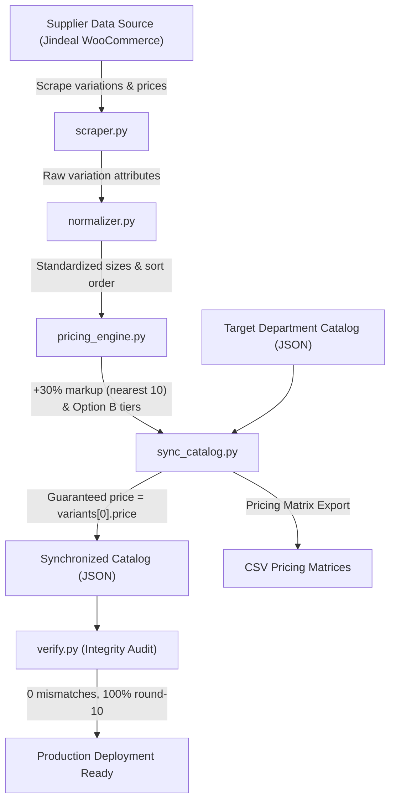

# variant-price-add

Enterprise multi-variant pricing synchronization, supplier scraper, and catalog consistency engine for craft and raw cosmetic ingredients e-commerce.

---

## 1. Executive Overview

In e-commerce catalogs offering raw chemicals, botanical bases, fragrance oils, and waxes, products are sold across heterogeneous metric sizes (e.g. `50 G`, `100 ml`, `200 G`, `500 ml`, `1 Litre`, `1 Kg`, `5 Kg`, `25 Kg`).

This repository provides an automated, idempotent pipeline to:
1. **Scrape live supplier pricing and variations** from WooCommerce backend stores.
2. **Normalize heterogeneous volume and weight labels** into standardized ascending metric sizes.
3. **Calculate profit-optimized retail markups (+30%)** rounded cleanly to the nearest ₹10.
4. **Generate Option B wholesale volume tiers** (1–9 units, 10–49 units, 50+ units).
5. **Guarantee Zero-Discrepancy Catalog Invariants**, ensuring product shelf cards (`From ₹{price}`) always strictly match the starting variant on the product detail page.

---

## 2. Architecture & Pipeline



---

## 3. Scope: Target Departments Covered

Per governance and catalog partitioning rules, this repository specifically manages the departments whose variable inventory requires automated multi-size pricing:

### A. Scent & Flavor Lab (333 Products)
- **Fragrance Oils / Skin Safe Fragrances:** 210 products
- **Essential Oils:** 88 products
- **Hydrosols & Floral Waters:** 22 products
- **Food-Grade Flavor Oils:** 11 products
- **Attar & Perfume Bottles:** Base perfumer's alcohols

### B. Casting Mediums & Raw Bases (111 Products)
- **Candle Waxes & Additives:** Soy, Beeswax, Paraffin, Gel wax (30 products)
- **Skincare & Body Bases:** Lotion, cream, and face serum bases (27 products)
- **Raw Butters & Carrier Oils:** Shea, Cocoa, Mango, Kokum, Cold-pressed oils (27 products)
- **Cosmetic Preservatives & Chemicals:** Geogard ECT, Olivem 1000, Phenoxyethanol (12 products)
- **Body & Facial Scrubs:** Foaming gel and sugar scrubs (8 products)
- **Haircare & Wash Bases:** Sulfate-free shampoos, hand washes, face washes (7 products)

*(Non-variable departments such as silicone casting moulds and tools are intentionally excluded from this pipeline).*

---

## 4. Core Business Logics & Mathematical Specifications

### A. Supplier Markup Formula
All base prices are derived directly from verified supplier reference prices marked up by **30%** and rounded to the nearest integer multiple of **₹10**:

$$\text{Retail Price} = \text{round}\left(\frac{\text{Supplier Price} \times 1.30}{10}\right) \times 10$$

*Example Calculations:*
- Supplier ₹99 $\rightarrow$ $99 \times 1.30 = 128.70 \rightarrow$ **₹130**
- Supplier ₹149 $\rightarrow$ $149 \times 1.30 = 193.70 \rightarrow$ **₹190**
- Supplier ₹649 $\rightarrow$ $649 \times 1.30 = 843.70 \rightarrow$ **₹840**
- Supplier ₹1,249 $\rightarrow$ $1,249 \times 1.30 = 1,623.70 \rightarrow$ **₹1,620**

### B. Standard Wholesale Discount Slabs (Option B)
Wholesale quantity discounts are computed per variant to incentivize bulk studio procurement:

| Tier | Order Quantity | Discount Level | Calculation |
| :---: | :---: | :---: | :--- |
| **Tier 1** | 1–9 units | 0% (Base Retail) | $\text{Base Retail Price}$ |
| **Tier 2** | 10–49 units | 5% Wholesale | $\text{round}(\text{Base} \times 0.95)$ |
| **Tier 3** | 50+ units | 10% Distributor | $\text{round}(\text{Base} \times 0.90)$ |

### C. The Zero-Discrepancy Catalog Invariant
To prevent customer drop-off and trust degradation caused by inconsistent pricing between shelf browsing and detail checkout:
1. **Top-Level Alignment:**
   $$\text{product.price} \equiv \text{product.variants}[0].\text{price}$$
   $$\text{product.tiers} \equiv \text{product.variants}[0].\text{tiers}$$
2. **Card UI Convention:**
   Cards render `From ₹{variants[0].price}` for variable items and `₹{price} (10+ Bulk: ₹{bulkPrice})` for single-size items.

---

## 5. Multi-Size Normalization Matrix

Heterogeneous supplier variation attributes are normalized and indexed by order of magnitude:

| Raw Attribute Slug | Normalized Label | Metric Base Value | Dimension Type |
| :--- | :---: | :---: | :---: |
| `50-gm`, `50gm` | `50 G` | 50 | Mass |
| `50-ml`, `50ml` | `50 ml` | 50 | Volume |
| `100gm`, `100-gm` | `100 G` | 100 | Mass |
| `100-ml`, `100ml` | `100 ml` | 100 | Volume |
| `200-gm`, `200gm` | `200 G` | 200 | Mass |
| `200-ml`, `200ml` | `200 ml` | 200 | Volume |
| `300-ml`, `300ml` | `300 ml` | 300 | Volume |
| `450gm`, `450-gm` | `450 G` | 450 | Mass |
| `500gm`, `500-gm` | `500 G` | 500 | Mass |
| `500-ml`, `500ml` | `500 ml` | 500 | Volume |
| `1-kg`, `1kg` | `1 Kg` | 1,000 | Mass |
| `1-litre`, `1-liter` | `1 Litre` | 1,000 | Volume |
| `5-kg`, `5kg` | `5 Kg` | 5,000 | Mass |
| `5-liter`, `5-litre` | `5 Litres` | 5,000 | Volume |
| `10kg`, `10-kg` | `10 Kg` | 10,000 | Mass |
| `25kg`, `25-kg` | `25 Kg` | 25,000 | Mass |
| `100-kg` | `100 Kg` | 100,000 | Mass |

---

## 6. Repository Structure

```
variant-price-add/
├── README.md                      # Comprehensive documentation and technical guide
├── requirements.txt               # Dependencies (beautifulsoup4, urllib3)
├── .gitignore                     # Git exclusions
├── run.py                         # CLI entrypoint for audit, sync, and scraping
├── src/
│   ├── __init__.py                # Package metadata
│   ├── scraper.py                 # WooCommerce variation extraction engine
│   ├── normalizer.py              # Size label normalization & metric sorting
│   ├── pricing_engine.py          # 30% markup & wholesale tier calculator
│   ├── sync_catalog.py            # End-to-end catalog synchronization pipeline
│   └── verify.py                  # Catalog invariant & integrity validator
└── data/
    ├── target_products.json       # Filtered dataset of the 444 managed products
    ├── scraped_supplier_data.json # Cached live variations from supplier pages
    └── matrices/                  # Exported CSV pricing matrices
        ├── food_grade_flavor_oils_pricing_matrix.csv
        ├── skincare_bases_and_chemicals_pricing_matrix.csv
        └── waxes_and_butters_pricing_by_size_matrix.csv
```

---

## 7. CLI Usage & Operations

### A. Run Integrity Audit
Checks that every product in the catalog satisfies all pricing invariants:
```bash
python run.py --audit
```
*Output:*
```
Auditing catalog: data/target_products.json
============================================================
Total Products: 444
Variable Products: 442
Price Mismatches: 0
Non-Round-10 Prices: 0
Tier Errors: 0
Missing Name/Title: 0
Catalog Invariant Status: VALID (0 Errors)
============================================================
```

### B. Run Catalog Synchronization
Synchronizes the catalog against the scraped supplier cache and generates a new pricing matrix:
```bash
python run.py --sync
```

### C. Live Test Scrape on Supplier URL
Extracts variation schemas and pricing directly from a target Jindeal product URL:
```bash
python run.py --scrape https://jindeal.com/product/vedini-orange-natural-flavor/
```
